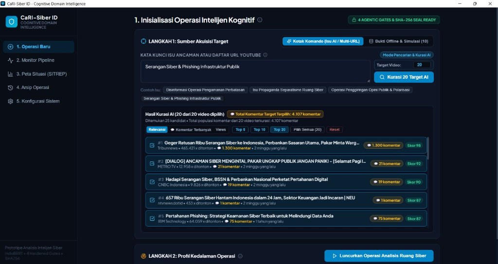
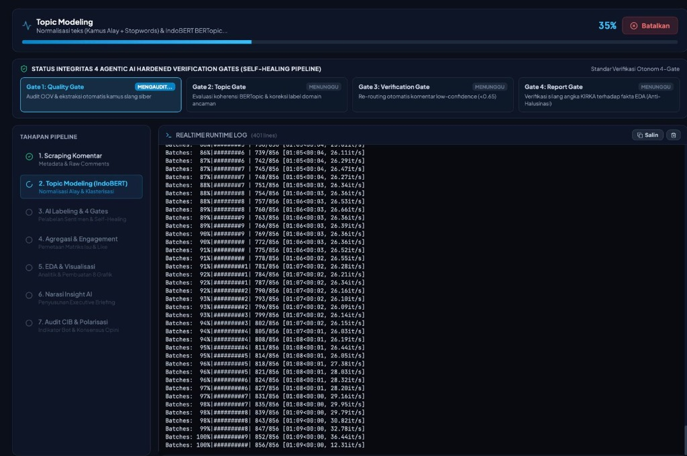
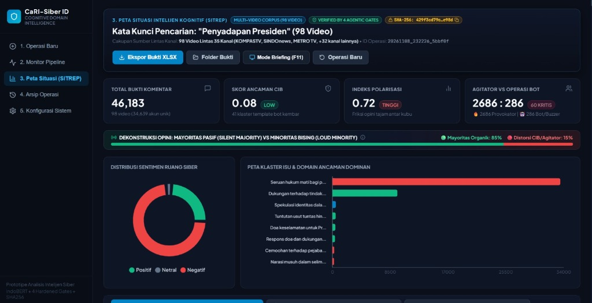
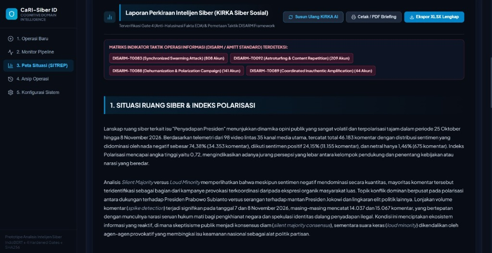
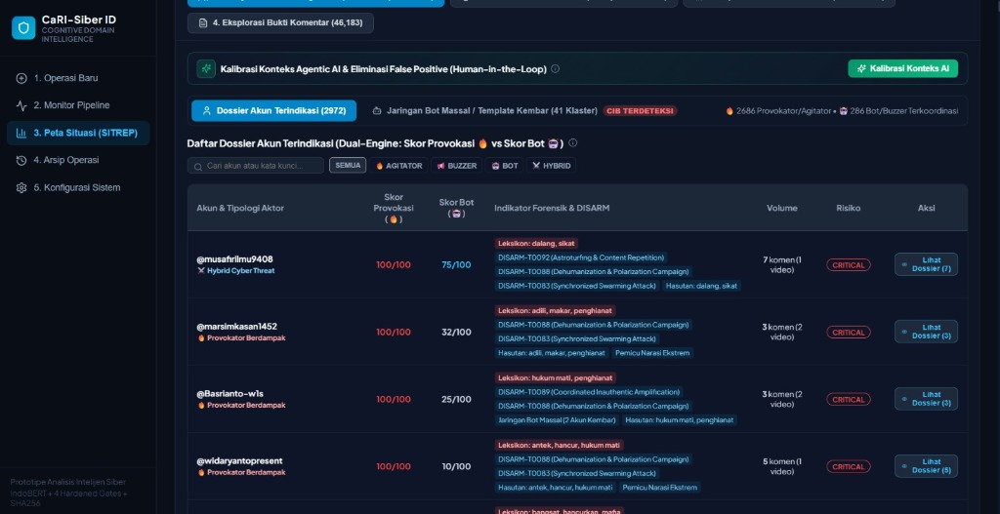

# 🛡️ CaRI-Siber ID – Sistem Intelijen Domain Kognitif & Forensik Ancaman Siber-Sosial

### _Platform Desktop Deteksi Operasi Informasi (CIB), Pemetaan Polarisasi, & Forensik Bukti Digital_

[](docs/ARSITEKTUR_DAN_ROADMAP_24_7.md)
[](README.md)
[](docs/PANDUAN_AWAM_DAN_EDUKASI.md)
[](README.md)
[](README.md)

---

> ### ⚠️ STATUS PROYEK: PROTOTIPE (PROOF-OF-CONCEPT)
> 
> **CaRI-Siber ID adalah aplikasi prototipe (Proof-of-Concept / PoC)** yang dikembangkan dalam waktu sekitar satu minggu untuk mengikuti sebuah hackathon.
> 
> **Latar Belakang & Fokus Saat Ini:**  
> Kombinasi **IndoBERT, BERTopic, dan LLM** yang menjadi *core engine* proyek ini merupakan adaptasi dari pendekatan yang sebelumnya telah dikembangkan untuk studi kasus lain, lalu diterapkan untuk menganalisis sentimen publik dan mengidentifikasi pola aktivitas mencurigakan di ruang siber (dengan **YouTube** sebagai salah satu sumber data utama, serta dukungan impor berkas CSV secara *offline*).
> 
> **Ruang Pengembangan Lanjutan:**  
> Prototipe ini masih memiliki ruang untuk pengembangan lebih lanjut, terutama pada validasi hasil deteksi, akurasi klasifikasi, dan pengujian pada skenario dunia nyata, serta cetak biru transisi menuju **Sistem Pemantauan Siber 24/7**.  
> 📖 _Baca cetak biru transisi teknis selengkapnya di [docs/ARSITEKTUR_DAN_ROADMAP_24_7.md](file:///d:/UNSIA/review-analysis/cari-siber-id/docs/ARSITEKTUR_DAN_ROADMAP_24_7.md)._

---

## 💡 Penjelasan untuk Orang Awam (Konsep 2 Menit)

Jika Anda bukan orang IT atau analis siber, jangan khawatir! Berikut rangkuman sederhana tentang apa dan mengapa aplikasi ini dibuat:

### 1. Masalah Nyata: "Perang Opini & Pasukan Buzzer"
Pernahkah Anda membaca kolom komentar di media sosial dan merasa suasananya sangat panas, penuh makian, adu domba suku/agama, atau memuji/menyerang figur tertentu secara berlebihan?  
Di dunia maya, **suara yang paling berisik sering kali bukan suara rakyat asli**, melainkan **pasukan robot (bot) dan buzzer bayaran** yang dibayar untuk merekayasa opini publik (*astroturfing*).

### 2. Solusi: "Radar Cuaca Siber"
Ibarat radar cuaca di bandara yang bisa membedakan mana awan hujan alami dan mana asap buatan dari pabrik, **CaRI-Siber ID** memindai ribuan komentar untuk memisahkan:
- **Mana suara tulus masyarakat biasa** (keluhan asli, apresiasi wajar).
- **Mana serangan terorganisir dari buzzer** (komentar *copypasta* yang teksnya persis sama disalin ke ratusan akun dan disebar dalam hitungan detik).

### 3. Mengapa Ada "Segel Bukti Digital SHA-256"?
Sama seperti polisi yang memasukkan barang bukti ke dalam amplop bersegel lak merah di TKP (*Chain of Custody*), setiap data komentar yang diunduh aplikasi ini langsung diberi **sidik jari digital (kriptografi SHA-256)**. Tujuannya agar data tersebut dijamin asli, sah secara hukum, dan tidak bisa diubah-ubah atau direkayasa oleh siapa pun.

### 4. Apa itu "Silent Majority" (Mayoritas yang Diam)?
Sering kali jutaan orang setuju atau tidak setuju dengan suatu hal, tetapi mereka malas berdebat di kolom komentar. Mereka hanya menekan tombol *Like*. Aplikasi ini menghitung rasio jempol (*likes*) untuk mengetahui apa yang sebenarnya dipikirkan oleh **mayoritas masyarakat yang tidak bersuara lantang**.

📖 _Ingin penjelasan lebih santai dan mendalam? Baca [docs/PANDUAN_AWAM_DAN_EDUKASI.md](file:///d:/UNSIA/review-analysis/cari-siber-id/docs/PANDUAN_AWAM_DAN_EDUKASI.md)._

---

## 🔍 Tahapan Pemrosesan Utama

```
[1. Data Collection & Relevance Filtering] ──► Cari video YouTube terkait topik & kurasi relevansi via LLM
                    │
                    ▼
[2. Topic Modeling & Sentiment Analysis]  ──► Normalisasi slang + IndoBERT & BERTopic + kurasi/label LLM
                    │
                    ▼
[3. Data Mining & Insight Generation]     ──► Ekstraksi pola & tren → ringkasan insight LLM → Dashboard
                    │
                    ▼
[4. Bot, Buzzer & Provocateur Detection]  ──► Analisis pola aktivitas akun, copypasta, & laporan (.xlsx)
```

1. **Data Collection & Relevance Filtering**: Pengguna memasukkan topik yang ingin dianalisis. Sistem mencari video YouTube terkait (atau menerima impor berkas CSV secara *offline*) dan mengkurasi relevansinya menggunakan *Large Language Model* (LLM).
2. **Topic Modeling & Sentiment Analysis**: Data komentar dinormalkan dari bahasa gaul/singkatan Indonesia, lalu diproses dengan **IndoBERT** dan **BERTopic** untuk pengelompokan topik. Hasilnya dikurasi kembali oleh LLM untuk pelabelan topik otomatis serta klasifikasi sentimen (**negatif, netral, positif**).
3. **Data Mining & Insight Generation**: Sistem melakukan *data mining* untuk menemukan pola dan kecenderungan dalam data, lalu mengolahnya melalui LLM menjadi ringkasan *insight* yang ditampilkan di dashboard interaktif.
4. **Bot, Buzzer & Provocateur Detection**: Modul untuk mengelompokkan komentar dan menganalisis pola aktivitas akun guna mengidentifikasi indikasi *bot*, *buzzer* (CIB), provokator, serta perilaku tidak wajar lainnya, lengkap dengan segel bukti **SHA-256** dan ekspor laporan Excel (**KIRKA**).

---

## 📸 Tangkapan Layar

### 1. Inisialisasi Operasi & Kurasi Target AI (*Data Collection & Relevance Filtering*)

_Pencarian video YouTube berdasarkan topik isu serta kurasi relevansi otomatis menggunakan LLM sebelum pengumpulan komentar._

### 2. Monitor Pipeline (*Topic Modeling & IndoBERT*)

_Proses normalisasi slang dan pemodelan topik berbasis IndoBERT + BERTopic secara real-time._

### 3. Dashboard Peta Situasi (*Data Mining, Sentimen & Klaster Isu*)

_Ringkasan distribusi sentimen, peta klaster isu hasil kurasi LLM, indeks polarisasi, serta rasio mayoritas organik vs distorsi CIB._

### 4. Ringkasan Narasi & Insight (*LLM Insight Generation*)

_Sintesis narasi analitis otomatis berbasis LLM yang merangkum pola temuan utama dan indikator taktik operasi informasi._

### 5. Deteksi Bot, Buzzer & Provokator (*Account Dossier*)

_Pemetaan skor provokasi vs skor bot per akun beserta indikator forensik dan fitur kalibrasi Human-in-the-Loop._

---

## 🏛️ Kapabilitas Utama & Keunggulan Taktis

### 1. 🔐 Integritas Bukti Kriptografis SHA-256 (*Chain of Custody*)
- Sesuai standar bukti elektronik **ISO/IEC 27037**, setiap korpus data mentah maupun artefak analitik otomatis disegel dengan hash **SHA-256** (`forensic_manifest.json`).
- Menjamin data tidak terkontaminasi atau dimanipulasi dari tahap pengumpulan hingga pelaporan eksekutif.

### 2. 🎯 Deteksi Buzzer (CIB) & Provokator (*Dual-Track Engine*)
- **Track A – CIB / Buzzer / Bot**: Mendeteksi pola *copypasta*, lonjakan pesan serentak (*rapid-fire burst*), dan anomali rasio akun duplikat.
- **Track B – Akun Berisiko Tinggi**: Memetakan akun provokator penyebar disinformasi, separatisme, ujaran SARA, dan ancaman siber/OT.

### 3. 🧠 Kalibrasi Konteks Human-in-the-Loop (< 2 Detik)
- Analis dapat menandai slogan positif warga (seperti *"NKRI Harga Mati"*) agar tidak salah terdeteksi sebagai spam buzzer (*anti-false positive*).
- Kalkulasi ulang skor ancaman berjalan instan (< 2 detik) tanpa perlu mengulang pengambilan data atau proses AI dari awal.

### 4. 🛡️ 4 Agentic AI Hardened Verification Gates (Bebas Halusinasi)
- **Gate 1 (*Quality Gate*)**: Normalisasi slang & sanitasi token.
- **Gate 2 (*Topic Gate*)**: Audit kohesi vektor IndoBERT & pencegahan *mega-blob*.
- **Gate 3 (*Verification Gate*)**: Verifikasi silang deterministik konfidensi $\ge 0,70$.
- **Gate 4 (*Report Gate*)**: Audit kecocokan angka persentase KIRKA terhadap tabel fakta mentah.

### 5. 🔌 Mode Intranet (*100% Air-Gapped Local LLM*)
- Dapat berjalan di lingkungan militer/pemerintahan yang **terisolasi tanpa internet sama sekali** menggunakan model **IndoBERT lokal** dan server **Ollama / vLLM lokal** (`http://127.0.0.1:11434/v1`).
- Penyimpanan kunci API terenkripsi pada **Windows Credential Manager / OS Keychain**.

---

## 🗺️ Roadmap: Menuju Sistem Monitoring 24/7 Non-Stop

| Fitur | Versi Prototipe Saat Ini (PoC) | Target Sistem Produksi 24/7 |
| :--- | :--- | :--- |
| **Arsitektur** | Desktop Standalone (PyWebView + React) | Distributed Cloud/On-Premise Microservices |
| **Siklus Analisis** | *On-Demand Snapshot* (per kasus/video) | *Continuous 24/7 Streaming Ingestion* |
| **Sumber Data** | YouTube otomatis + Impor file medsos offline | Direct Stream API: X, TikTok, IG, YouTube, Telegram |
| **Notifikasi** | Layar desktop setelah proses selesai | Peringatan instan (< 5 detik) ke Telegram/Signal/SIEM |
| **Penyimpanan** | SQLite lokal (`history.db`) | Distributed PostgreSQL (pgvector) + Neo4j Graph DB |
| **Tujuan** | Uji Coba Cepat & Pembuktian Algoritma | Pusat Komando Pertahanan Kognitif Skala Penuh |

---

## 💻 Persyaratan Sistem

- **Sistem Operasi**: Windows 10/11 (64-bit) atau macOS 11.0+ (Apple Silicon / Intel).
- **Python**: Python 3.10, 3.11, atau 3.12.
- **Node.js**: Node.js 18+ & npm (untuk kompilasi antarmuka frontend).
- **Mode Operasi**:
  - **Mode Online**: Koneksi internet untuk akuisisi YouTube & LLM Cloud (Gemini/OpenRouter).
  - **Mode Air-Gapped**: 100% offline dengan model IndoBERT lokal dan server Ollama lokal.

---

## 🚀 Panduan Menjalankan (Mode Pengembangan)

### 1. Kloning Repositori & Persiapan Python

```bash
git clone https://github.com/anggaalfiansah/cari-siber-id.git
cd cari-siber-id

# Buat virtual environment
python -m venv .venv

# Aktivasi lingkungan:
# Windows (PowerShell):
.venv\Scripts\activate
# macOS / Linux:
source .venv/bin/activate

# Pasang dependensi
pip install --upgrade pip
pip install -r requirements.txt
```

### 2. Kompilasi Antarmuka Desktop (React/Vite)

```bash
cd frontend
npm install
npm run build
cd ..
```

### 3. Menjalankan Aplikasi Desktop

```bash
python main.py
```
*(Tambahkan argumen `--dev` jika ingin menghubungkan antarmuka ke Vite Dev Server di `localhost:5173`).*

---

## 📦 Panduan Membangun Installer (Distribusi Produksi)

### A. Windows Installer (NSIS Setup `.exe`)
```powershell
# 1. Kompilasi Executable Windowed (tanpa terminal hitam)
pyinstaller CaRI-Siber-ID.spec --clean --noconfirm

# 2. Kemas Menjadi Installer Resmi NSIS
& "C:\Program Files (x86)\NSIS\makensis.exe" installer.nsi
```
_Hasil installer berada di `dist/CaRI-Siber-ID-Setup.exe`._

### B. macOS Application (`.app` & `.dmg`)
```bash
# 1. Kompilasi Bundle macOS
pyinstaller CaRI-Siber-ID.spec --clean --noconfirm

# 2. Kemas Menjadi Installer Drag-and-Drop .dmg
create-dmg --volname "CaRI-Siber ID Installer" "dist/CaRI-Siber-ID-Installer.dmg" "dist/CaRI-Siber-ID.app"
```

---

## 📂 Struktur Proyek

```text
cari-siber-id/
├── docs/                           # Dokumentasi Komprehensif
│   ├── PANDUAN_AWAM_DAN_EDUKASI.md # Penjelasan konsep, analogi, & panduan non-teknis
│   └── ARSITEKTUR_DAN_ROADMAP_24_7.md # Cetak biru transisi prototipe menuju sistem 24/7
├── cari_siber/                     # Paket Inti Backend & Mesin AI
│   ├── desktop/                    # Window pywebview, bridge RPC API, & event emitter
│   ├── engine/                     # IndoBERT, BERTopic, 4 Agentic Gates, & Excel Reporter
│   ├── services/                   # History DB SQLite, CIB Dual-Track, & SHA-256 Forensik
│   ├── paths.py                    # Resolusi path lintas platform (Appdata/Local)
│   ├── settings.py                 # Keyring terenkripsi OS & manajemen konfigurasi
│   └── ui_dist/                    # Bundle hasil kompilasi frontend produksi
├── frontend/                       # Source Code Antarmuka Desktop (React 19 + TypeScript + Vite 8)
│   ├── src/
│   │   ├── components/             # AboutModal (Info PoC), Sidebar, KpiCard, TopicTable
│   │   ├── pages/                  # NewAnalysis, Progress, Result (SITREP), History, Settings
│   │   └── api/                    # Bridge PyWebView & tipe data
├── resources/                      # Kamus Slang, Stopwords, & Korpus Simulasi Bawaan (.csv)
├── CaRI-Siber-ID.spec              # Konfigurasi PyInstaller lintas platform
├── installer.nsi                   # Skrip kompilator NSIS Windows
├── main.py                         # Entry point utama aplikasi
└── README.md                       # Dokumentasi resmi repositori
```

---

## 🔒 Keamanan Siber & Kedaulatan Data

- **Zero External Data Leak**: Seluruh data komentar, basis data SQLite (`history.db`), berkas hash forensik (`forensic_manifest.json`), dan aturan kalibrasi disimpan 100% di direktori pengguna lokal (`%LOCALAPPDATA%\CaRI-Siber-ID`).
- **Penyimpanan Kunci API Terenkripsi**: Kunci API tidak disimpan dalam teks polos (*plaintext*), melainkan dilindungi menggunakan **Windows Credential Manager** atau **macOS Keychain** melalui pustaka `keyring`.

---

## 👥 Pengembang & Hak Cipta
Dikembangkan sebagai instrumen riset dan demonstrasi intelijen domain kognitif, pembongkaran manipulasi informasi terkoordinasi (CIB), serta forensik bukti digital berstandar nasional.
