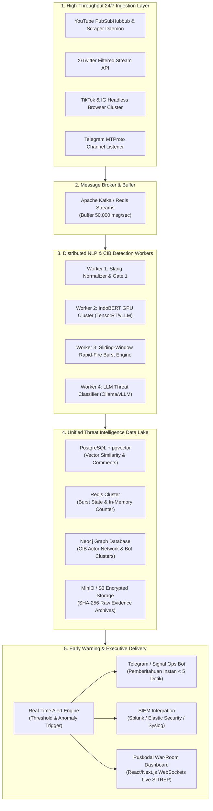

# 🏛️ Arsitektur Sistem & Cetak Biru Roadmap 24/7 (CaRI-Siber ID)

> **Catatan Analis & Rekayasa Perangkat Lunak:**  
> Dokumen ini disusun oleh *Senior Software Engineer & Analis Keamanan Siber* untuk membedah arsitektur teknis saat ini, batasan implementasi prototipe yang dibuat cepat untuk mengejar tenggat waktu (*deadline*), serta cetak biru komprehensif (*blueprint*) menuju **Sistem Pemantauan Domain Kognitif & Siber-Sosial Otomatis 24/7 Berkelanjutan**.

---

## 1. 📌 Status Proyek: Prototipe Fungsional (Proof-of-Concept / PoC)

Aplikasi **CaRI-Siber ID** yang ada di repositori ini adalah implementasi **prototipe desktop mandiri** (*standalone desktop application*) yang memadukan **Python 3 (Backend Core)** dan **React 18 + Vite (Frontend UI)** melalui jembatan **PyWebView**.

### Mengapa Berupa Prototipe Desktop?
1. **Target Validasi Cepat (*Rapid Proof-of-Value*)**: Membuktikan bahwa algoritma pemodelan topik lokal (**IndoBERT + BERTopic**), **Deteksi Buzzer (CIB Dual-Track)**, dan **Penyegelan Bukti Digital SHA-256** dapat bekerja secara harmonis tanpa halusinasi (*4 Hardened Verification Gates*).
2. **Kedaulatan & Kerahasiaan Penuh (*Air-Gap Ready*)**: Memungkinkan instansi keamanan, militer, atau universitas menguji sistem pada jaringan lokal terisolasi (*air-gapped*) tanpa risiko kebocoran data intelijen ke server pihak ketiga.
3. **Mengejar Tenggat Waktu Singkat**: Dalam rangka menyelesaikan penugasan dan pengujian awal secara tepat waktu, ruang lingkup difokuskan pada akuisisi berbasis insiden/isu (*batch snapshot*) pada YouTube dan impor berkas multi-platform offline.

---

## 2. 🔍 Arsitektur Saat Ini (Desktop Batch Pipeline)

```
[Target URL / Kata Kunci / Berkas CSV/XLSX]
                     │
                     ▼
┌─────────────────────────────────────────────────────────────┐
│ 1. Ingestion Engine (YouTube Scraper / OSINT Importer)     │
│    - Akuisisi komentar mentah & metadata penonton           │
│    - Penyegelan kriptografis SHA-256 (forensic_manifest)    │
└────────────────────────────┬────────────────────────────────┘
                             │
                             ▼
┌─────────────────────────────────────────────────────────────┐
│ 2. Gate 1: Quality Gate & Preprocessing                    │
│    - Normalisasi kamus slang/gaul Indonesia (Nasalsabila)   │
│    - Filter stopwords, emoji, karakter kontrol non-UTF8     │
└────────────────────────────┬────────────────────────────────┘
                             │
                             ▼
┌─────────────────────────────────────────────────────────────┐
│ 3. Gate 2: IndoBERT Embedding & BERTopic Clustering        │
│    - Ekstraksi semantik lokal (indobert-base-p1)            │
│    - Pengelompokan isu, anti-blob guardrails & deduplikasi │
└────────────────────────────┬────────────────────────────────┘
                             │
                             ▼
┌─────────────────────────────────────────────────────────────┐
│ 4. Gate 3 & CIB Engine: Dual-Track Anomaly & Verification  │
│    - Track A: Copypasta clustering & rapid-fire burst      │
│    - Track B: 6 Domain Ancaman (Disinfo/Separatisme/SARA)   │
│    - Human-in-the-Loop Context Calibrator (< 2 detik)       │
└────────────────────────────┬────────────────────────────────┘
                             │
                             ▼
┌─────────────────────────────────────────────────────────────┐
│ 5. Gate 4: SITREP Dashboard & Laporan KIRKA (.xlsx)         │
│    - Cross-audit fakta numerik terhadap CSV sumber         │
│    - Polarisasi, Silent Majority, & Rekomendasi Taktis      │
└─────────────────────────────────────────────────────────────┘
```

### Karakteristik & Limitasi Arsitektur Saat Ini
- **Model Eksekusi**: *On-Demand / Episodic*. Analisis dijalankan saat pengguna memasukkan target dan menekan tombol mulai.
- **Penyimpanan**: SQLite lokal (`history.db`) dan berkas artefak JSON/CSV lokal di `%LOCALAPPDATA%`.
- **Cakupan Platform Otomatis**: YouTube (Scraper terintegrasi); Platform lain (X, TikTok, Telegram, Instagram) saat ini dilayani melalui fitur **Universal Importer Bukti Digital** (`.CSV`, `.JSON`, `.XLSX`).

---

## 3. 🚀 Cetak Biru Menuju Sistem Monitoring Siber 24/7 Non-Stop

Untuk meningkatkan prototipe ini menjadi **Pusat Komando & Pengendalian Operasi Siber (SOC / Cognitive Defense Center)** skala nasional yang terus beroperasi 24 jam sehari, 7 hari seminggu tanpa jeda, arsitektur bertransisi dari *Desktop Batch* menjadi **Distributed Event-Driven Microservices**.



### Rincian Komponen Produksi 24/7:

### A. Lapisan Ingesti Berkelanjutan (*Continuous Ingestion Daemon*)
1. **YouTube Automated Poller**: Memantau saluran berita nasional dan kanal strategis menggunakan webhook PubSubHubbub untuk mendeteksi unggahan baru seketika.
2. **X (Twitter) Filtered Stream**: Mendengarkan kata kunci sensitif pertahanan, hoaks kedaulatan, dan polarisasi politik via streaming API.
3. **TikTok & Instagram Distributed Crawler**: Menggunakan *pool headless browser* (Playwright/Camoufox) dengan *rotating residential proxies* dan fingerprint spoofing untuk menghindari pemblokiran IP saat memantau video viral.
4. **Telegram OSINT Monitor**: Menggunakan pustaka *MTProto* (Telethon) untuk memonitor saluran-saluran propaganda separatisme, kebocoran data (*doxxing*), dan forum judi online/phishing secara pasif.

### B. Antrean Pesan Skalabilitas Tinggi (*Message Broker*)
- Menggunakan **Apache Kafka** atau **Redis Streams** untuk menampung lonjakan komentar hingga puluhan ribu komentar per detik saat terjadi peristiwa krisis (misalnya gempa bumi, pemilu, kerusuhan, atau insiden keamanan siber).

### C. Mesin Deteksi Anomali Waktu-Nyata (*Real-Time CIB & NLP Engine*)
- **Sliding-Window Rapid-Fire Detection**: Menggunakan struktur data *Redis Sorted Sets* untuk menghitung kemunculan komentar identik dalam jendela waktu geser 60 detik. Jika ada lebih dari 10 komentar sama dari akun berbeda dalam 5 detik, alarm CIB otomatis menyala.
- **Dedicated GPU Inference Cluster**: Menjalankan model IndoBERT pada server berakselerasi GPU (Nvidia A10/T4 dengan TensorRT-LLM) sehingga inferensi embedding memakan waktu kurang dari 5 milidetik per komentar.
- **Actor Graph Correlation (Neo4j)**: Membangun graf relasi aktor: Akun mana yang selalu mengomentari video bersamaan? Siapa pembawa narasi pertama (*seed account*)? Siapa jaringan pendengung (*amplification accounts*)?

### D. Sistem Peringatan Dini (*Early Warning & War-Room Dashboard*)
- Saat ambang batas polarisasi (**Polarization Index > 0.75**) atau lonjakan ancaman kekerasan terlewati, sistem mengirimkan **Push Alert** ke ponsel pejabat komando via Telegram/Signal dalam hitungan detik.
- Dashboard Pusat Komando Operasi (Puskodal) menampilkan peta panas (*heat map*) wilayah dan klaster narasi yang bergerak secara dinamis (*live streaming via WebSockets*).

---

## 4. 🛡️ Analisis Keamanan & Rekayasa Cyber (Security Review)

Sebagai analis siber, aspek keamanan perangkat lunak (*software security*) dan keamanan operasi (*OPSEC*) menjadi perhatian utama dalam desain arsitektur:

| Aspek Keamanan | Implementasi pada Prototipe Saat Ini | Standar pada Target Produksi 24/7 |
| :--- | :--- | :--- |
| **Integritas Bukti (*Chain of Custody*)** | Algoritma hashing SHA-256 dicatat pada `forensic_manifest.json` per eksekusi. | Merkle Tree kriptografis terdesentralisasi / Immutable Append-Only Ledger (misal: QLDB / Hyperledger). |
| **Kerahasiaan Kredensial API** | Disimpan pada Windows Credential Manager / macOS Keychain via pustaka `keyring`. | HashiCorp Vault / AWS Secrets Manager dengan rotasi kunci otomatis (*key rotation*). |
| **Kedaulatan Data (*Air-Gap Capability*)** | 100% data tersimpan di mesin lokal pengguna; mendukung Local LLM (Ollama/vLLM) tanpa internet. | On-Premise Kubernetes Cluster (Air-Gapped Private Cloud) dengan model LLM berbobot terbuka (*open-weights*). |
| **Anti-Poisoning & Anti-Jailbreak** | Gate 3 (Deterministik Confidence Floor $\ge 0.70$) & Gate 4 (Audit Kutipan Angka). | Multi-Agent Adversarial Red-Teaming, Prompt Injection Guardrails (NeMo Guardrails), & Output Token Sanitation. |
| **Ketahanan Crawler (*Scraper OPSEC*)** | Polling cerdas dengan header browser umum dan penanganan backoff otomatis. | Residential Rotating Proxy Pool, TLS Client Fingerprint Randomization (JA3/JA4), & CAPTCHA Solver Evasion. |

---

## 5. 📊 Matriks Komparasi: Prototipe vs Sistem 24/7

| Fitur / Parameter | Prototipe Saat Ini (PoC) | Target Sistem Produksi 24/7 |
| :--- | :--- | :--- |
| **Bentuk Aplikasi** | Aplikasi Desktop Mandiri (PyWebView) | Platform Web Terdistribusi Cloud/On-Premise |
| **Metode Pemantauan** | Analisis Sesuai Permintaan (*On-Demand Batch*) | Pemantauan Non-Stop 24/7 Berbasis Streaming |
| **Platform yang Dipantau** | YouTube Otomatis + Impor Multi-Medsos Offline | YouTube, X, TikTok, IG, Telegram Terintegrasi Langsung |
| **Volume Komentar** | 500 – 20.000 komentar per sesi | Jutaan komentar per hari secara berkelanjutan |
| **Penyimpanan Data** | SQLite Lokal (`history.db`) | PostgreSQL (pgvector) + Neo4j + Redis Cluster |
| **Notifikasi Peringatan** | Ditampilkan di UI Desktop setelah proses selesai | Push Notification Telegram/Signal/Email dalam < 5 detik |
| **Tujuan Pengembangan** | Pengujian Algoritma & Pembuktian Konsep Cepat | Operasi Pertahanan Informasi Skala Nasional |

---

## 6. 🏁 Kesimpulan

Aplikasi **CaRI-Siber ID** membuktikan bahwa kombinasi pemodelan topik berbasis transformer lokal (**IndoBERT**), arsitektur verifikasi bebas halusinasi (**4 Hardened Gates**), serta pengawasan terstruktur terhadap pola koordinasi buzzer (**CIB Dual-Track**) dapat diwujudkan secara andal dan cepat. 

Prototipe ini menjadi pondasi kokoh bagi pengembangan tahap berikutnya menuju platform pengawasan kognitif 24/7 yang tangguh, menjaga ruang digital Indonesia dari polarisasi palsu dan serangan disinformasi terorganisir.
